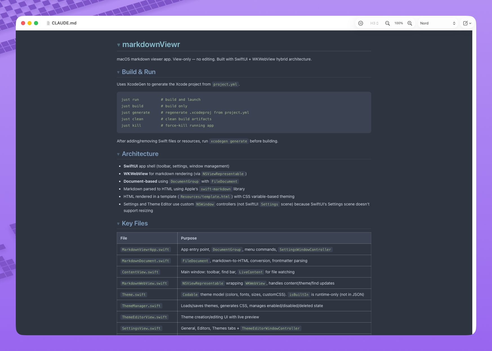

# markdownViewr

> **This is KofTwentyTwo's contribution fork of [darinkelkhoff/markdownViewr](https://github.com/darinkelkhoff/markdownViewr).** It publishes no builds. The download, Homebrew cask and Sparkle updates below all come from the upstream project. The fork carries printing work that is offered upstream: native printing merged as [darinkelkhoff/markdownViewr#2](https://github.com/darinkelkhoff/markdownViewr/pull/2), and the print-styling fixes are open as [#3](https://github.com/darinkelkhoff/markdownViewr/pull/3). Report app issues upstream. The Windows port is [KofTwentyTwo/MarkdownViewr.Windows](https://github.com/KofTwentyTwo/MarkdownViewr.Windows).

A fast, beautiful markdown viewer for macOS. Open any markdown file — it live-reloads as you edit in your favorite editor.

[](https://github.com/darinkelkhoff/markdownViewr/releases/latest/download/markdownViewr.dmg)




## Download

**[Download for Mac](https://github.com/darinkelkhoff/markdownViewr/releases/latest/download/markdownViewr.dmg)** — macOS 13 Ventura or later, free.

Open the DMG, drag markdownViewr to Applications, and you're done.

Or install via Homebrew:

```bash
brew install --cask darinkelkhoff/tap/markdownviewr
```

## Features

- **GitHub Flavored Markdown** — tables, task lists, strikethrough, fenced code blocks
- **Themed code blocks** — monospaced, with configurable code font and size
- **Fully customizable themes** — built-in theme editor, unlimited user themes, custom CSS
- **Table of contents** — toggleable, resizable, depth picker, depth markers, jump-to-heading
- **Markdown source view** — side-by-side raw source, find across both panes, heading scroll-sync, collapse mirroring
- **Collapsible headings** — click a heading to collapse its section, ⌥-click to anchor to it
- **Live file watching** — re-renders on every save, scroll position preserved
- **Vim navigation keys** — `j`/`k`, `Ctrl+d`/`u`, `gg`/`G`, `]]`/`[[`
- **Find in document** — with match count and vim-style `/`, `n`, `N`
- **YAML frontmatter** — hide, show as a metadata table, or render as Markdown
- **Open in external editor** — configure any editor or app, one click from the toolbar
- **Automatic updates** — stays current via Sparkle

## Keyboard Shortcuts

| Key | Action |
|---|---|
| `j` / `k` | Scroll down / up |
| `Ctrl+d` / `Ctrl+u` | Half page down / up |
| `gg` / `G` | Top / bottom of document |
| `]]` / `[[` | Next / previous heading |
| `⌘F` | Find |
| `/` | Focus find bar (vim-style) |
| `n` / `N` | Next / previous match |
| `⌘⇧↓` / `⌘⇧↑` | Next / previous theme |

## Building from Source

Requires Xcode 15+, [XcodeGen](https://github.com/yonaskolb/XcodeGen), and [just](https://github.com/casey/just).

```bash
git clone https://github.com/darinkelkhoff/markdownViewr.git
cd markdownViewr
just run
```

`just --list` shows all available recipes.
